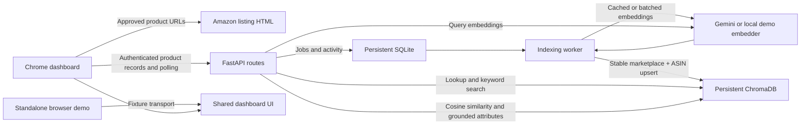
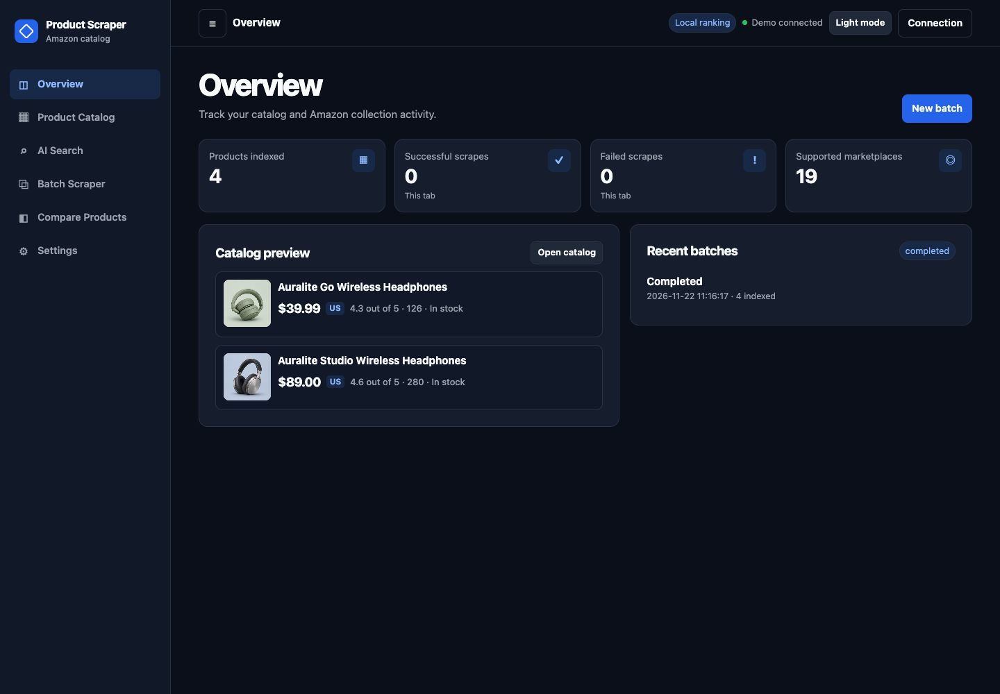
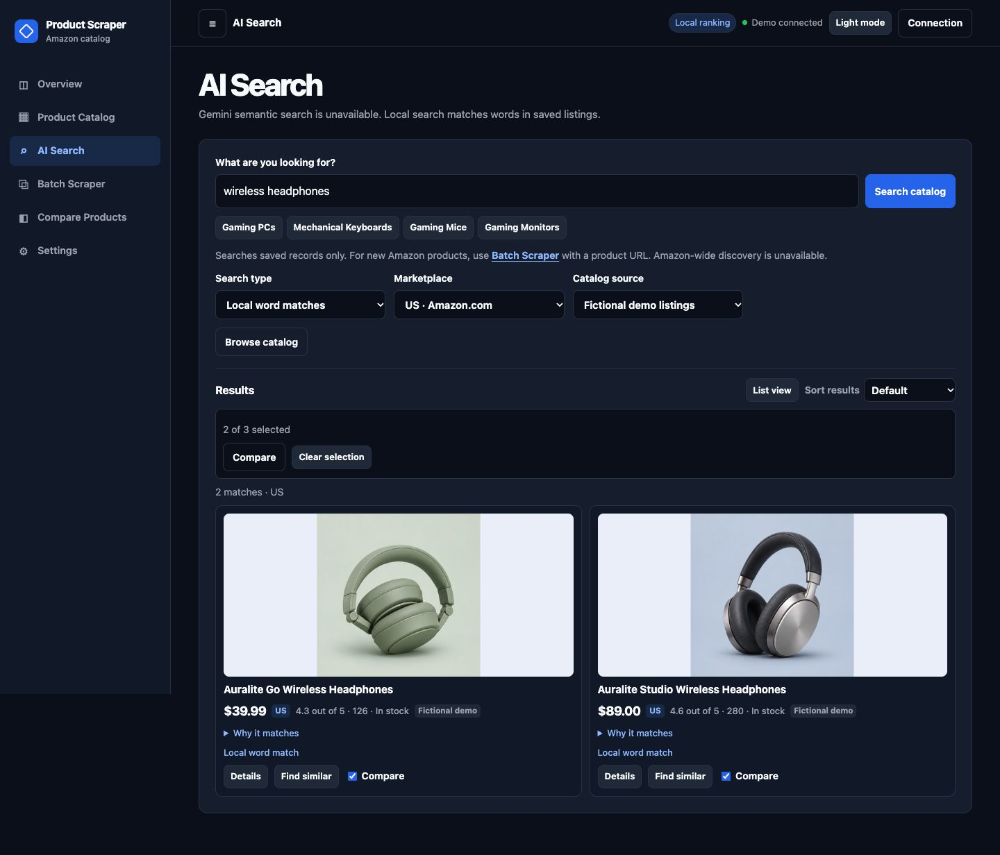
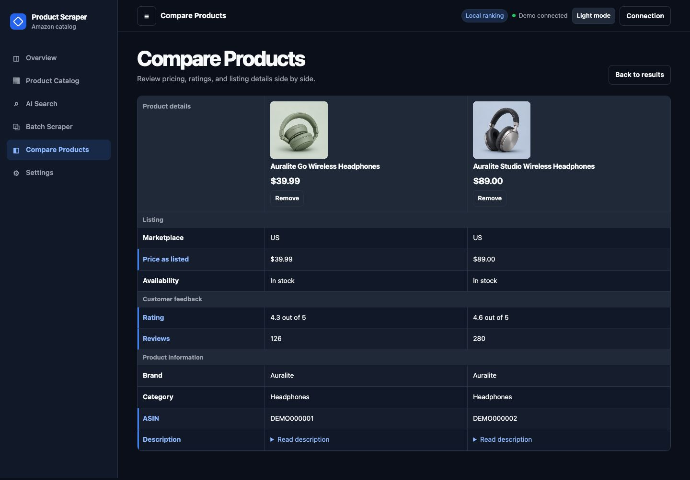

# Amazon Product Scraper

Collect product details from Amazon listings, organize them by marketplace, and find or compare products in a saved catalog. The project combines a Manifest V3 Chrome extension, a FastAPI API, a durable SQLite indexing queue, Gemini embeddings, and ChromaDB.

[](https://github.com/hassana42/amazon-product-scraper/actions/workflows/ci.yml)
[](extension/)
[](backend/)

## Key features

- Collect up to 40 Amazon product URLs across 19 marketplaces, with progress, retries, and CSV or JSON exports.
- Browse, filter, and compare saved listings. The extension defaults to Amazon.com.
- Search a persistent catalog using local listing evidence or optional Gemini embeddings with ChromaDB.
- Run a separate, fictional demonstration catalog without credentials.

## Tech stack

TypeScript and Chrome Manifest V3 for the dashboard and collector, Python and FastAPI for the API, SQLite for durable indexing jobs and embedding caches, ChromaDB for product records and vectors, and Gemini for optional embeddings. Docker Compose runs the local backend. Pytest, Vitest, Playwright, and GitHub Actions exercise the workflows.

## Try the recruiter demo

The browser demo runs from the same TypeScript dashboard with a clearly labeled fixture catalog. It includes product images, simulated indexing, keyword and local listing-evidence search, and side-by-side comparison. It needs neither Chrome installation nor an API key.

```sh
npm --prefix extension ci
npm --prefix extension run build
python3 -m http.server 8080 --bind 127.0.0.1 --directory extension/dist
```

Open [the browser demo](http://127.0.0.1:8080). Amazon.com is the default marketplace. Try searching for **wireless headphones**, select both headphones, and choose **Compare**. You can also load and index the sample batch. The sample products and their generated photos are fictional. The browser demo stores its changes in memory until the page reloads.

## Run the full stack

You need Chrome, Node.js 24+, and Docker with Compose v2. Python 3.12 is needed for running the backend outside Docker or executing the Python test suite.

1. Copy `.env.example` to `.env`. Generate a backend key with `openssl rand -hex 32` and put it in `SCRAPER_API_KEY`.
2. Start the API and build the extension.

   ```sh
   docker compose up --build --wait
   npm --prefix extension ci
   npm --prefix extension run build
   ```

3. Open `chrome://extensions`, enable **Developer mode**, select **Load unpacked**, and choose `extension/dist`. Click the extension's toolbar icon.
4. Open **Connection**, leave the address at `http://127.0.0.1:8000`, enter the backend key from `.env`, and choose **Check connection**. The dashboard checks availability every 15 seconds after connecting. The origin is saved locally and the backend key stays in the open dashboard tab.
5. In **Batch Scraper**, choose **Load demo batch** and **Save to catalog** to index sample records. In **AI Search**, switch **Catalog source** to **Fictional demo listings** to find them. Paste approved Amazon listing URLs for real collection. Successful items can be exported immediately or saved to the catalog. **Import JSON** accepts up to 40 records from an authorized source, with US as the default for records that omit the marketplace. **Recent indexing activity** reports the outcome of saved batches.

### Environment

| Variable | Purpose |
| --- | --- |
| `SCRAPER_API_KEY` | Private shared key for authenticated catalog and batch API calls |
| `EMBEDDING_MODE` | `demo` for local token vectors or `gemini` for Gemini embeddings |
| `GEMINI_API_KEY` | Server-side Google key required only for `gemini` |
| `CORS_ORIGINS` | Optional comma-separated trusted web origins. Chrome extension origins are supported directly. |
| `SCRAPER_PORT` | Loopback host port used by Compose, default `8000` |
| `CHROMA_PATH` | Local data directory. Compose sets it to `/data/chroma`. |

To switch to Gemini, update `.env` and run `docker compose up -d --wait`. Demo and Gemini catalogs stay separate because their vector spaces differ. If no Gemini key is available, the backend uses local lexical search. The extension defaults to Saved listings, and the Fictional demo listings selector explicitly switches sources. Load or import product records in the selected mode. For deployment, use an HTTPS reverse proxy, keep secrets in the host's secret store, and run one API worker with the embedded database and queue. The included local Compose configuration exposes the API only on loopback. To run natively, export the variables and run `python -m uvicorn backend.app:app`.

## Architecture



- The browser validates canonical HTTPS Amazon URLs, deduplicates by marketplace and ASIN, and parses HTML in an inert template. A batch can process up to three marketplaces concurrently and only one request at a time per marketplace, with a 650 ms pause. It stops that marketplace after verification, a redirect, rate limiting, or an access restriction. Selected transient server errors get one retry. Responses have a 15-second request timeout and a 10 MB HTML limit.
- The extension shows queued, processing, succeeded, failed, and skipped lines. It retains completed products when retrying failed URLs. Scrape totals represent successful requests in the current tab. Recent indexing activity comes from persisted job records.
- The API accepts validated product records from the extension or an authorized data provider. It does not fetch submitted links or image URLs. Backend outbound requests target the fixed Gemini endpoint. The extension uses HTTPS for approved marketplace pages and Amazon image CDN hosts, and allows HTTP only for a loopback backend.
- SQLite stores indexing jobs and embedding cache entries. Interrupted jobs are resumed on startup. ChromaDB persists listings and vectors under a stable key, so repeat upserts replace existing records.
- Recommendations search saved products, not Amazon-wide inventory. Both retrieval paths require normalized query terms in listing fields and at least one title, category, or brand match. Product nouns must match identity fields, so a headphone description mentioning PC compatibility cannot qualify for “gaming PC.” A small documented set of aliases covers plurals, desktop PCs, and Bluetooth for wireless evidence. Local results rank by identity matches and show no cosine score. Gemini mode ranks evidence-qualified candidates in ChromaDB and suppresses non-positive cosine matches. The evidence gate deliberately favors precision and can miss paraphrases the listing does not substantiate. Matched terms are found in stored listing text. The UI shows missing details explicitly and preserves prices in their source currencies. Keyword and browse pages load 20 products at a time. Sorting applies to the loaded results.
- The 19 supported storefronts are US, CA, MX, BR, UK, DE, FR, IT, ES, NL, SE, PL, BE, AU, JP, IN, AE, SA, and EG.

## API

Interactive docs are available at [localhost:8000/docs](http://127.0.0.1:8000/docs). Except for health and documentation, requests require the `X-API-Key` header. Listing search and recommendations default to US and saved listings. Use source=demo to search fictional records or source=all to explicitly include both. Send `marketplace=all` (or JSON `"marketplace": null` for recommendations), or `market=all` for similar products, to include every market.

| Method | Path | Behavior |
| --- | --- | --- |
| GET | `/health` | Catalog readiness |
| GET | `/v1/status` | Embedding mode, product count, and recent jobs |
| POST | `/v1/batches` | Queue a batch of 1–40 product records |
| GET | `/v1/batches/{id}` | Check queued, processing, completed, or failed status |
| POST | `/v1/products` | Synchronous upsert for an authorized data source |
| GET | `/v1/products?q=wireless&marketplace=US` | Browse and keyword search with limit and offset |
| GET | `/v1/products/{marketplace}/{asin}` | Retrieve a product |
| GET | `/v1/products/{marketplace}/{asin}/similar` | Rank other products relative to one saved product |
| POST | `/v1/recommendations` | Natural-language search with an optional marketplace filter |

For authorized imports, use the [sample record format](extension/static/demo-products.json) as the `products` array. An example recommendation request is `{"query":"wireless headphones for travel","marketplace":"US","limit":5}`.

## Tests

```sh
python3.12 -m venv .venv
source .venv/bin/activate
python -m pip install --upgrade pip
python -m pip install -r requirements-dev.txt
ruff check backend tests scripts
python -m pytest -q
npm --prefix extension ci
npm --prefix extension run lint
npm --prefix extension test
```

For the browser suite, use a fresh demo catalog to isolate fixture counts from saved products. Run an isolated Compose project on an unused port and export its API key. The following example leaves your regular catalog untouched.

```sh
export SCRAPER_API_KEY="$(openssl rand -hex 32)" EMBEDDING_MODE=demo
export SCRAPER_PORT=18000 SCRAPER_ORIGIN=http://127.0.0.1:18000
docker compose -p scraper-test up --build --wait
npx --prefix extension playwright-core install chromium
npm --prefix extension run test:browser
python3 scripts/smoke_demo.py --origin "$SCRAPER_ORIGIN"
docker compose -p scraper-test down --volumes
```

CI runs the unit suites, type checking, the Chromium smoke suite, and Docker verification before and after container recreation. Browser tests mock Amazon HTML and CDN responses, and Python tests mock Gemini. Both use a real local catalog where persistence is under test.

## Dashboard

The dark workspace has dedicated pages for Overview, Product Catalog, AI Search, Batch Scraper, Compare Products, and Settings. Catalog and search retain separate queries and results while you navigate. Settings saves the theme, default marketplace, and grid or list preference in the browser. Connection credentials stay in the open tab.

- **Overview** shows indexed-product counts, this tab’s scrape outcomes, and persisted indexing jobs.
- **Product Catalog and AI Search** show photos, prices, ratings, and marketplace badges. Recommendation evidence is expandable. The header identifies Gemini, local ranking, or the standalone browser demo.
- **Compare Products** keeps product headers visible during scroll and highlights differences without converting currencies or inventing missing values.







Screenshots were captured during the browser test with fixture data.

## Known limitations

Amazon controls live availability, markup, and access restrictions. Live Chrome verification collected the Soundcore Space 2 and AeroClip from Amazon.com, including their images and USD prices. Both were saved and queried against the local ChromaDB catalog. A separate example returned HTTP 404 and was reported as a failed extraction. Automated extraction also uses permitted fixtures. Gemini's HTTP integration is tested with a mock provider. Live Gemini verification requires a configured account and key. The browser demo uses local matching and simulated jobs. It does not execute Amazon requests or use Gemini. The project does not calculate currency conversions or guarantee that displayed listing prices are current.

Implementation references include [Chrome Manifest V3](https://developer.chrome.com/docs/extensions/reference/manifest), [Gemini embeddings](https://ai.google.dev/gemini-api/docs/embeddings), and [Chroma configuration](https://cookbook.chromadb.dev/core/configuration/).


## Dependency security

The local stack embeds ChromaDB with `PersistentClient` and fixed embedding configuration. The Compose service publishes FastAPI only on loopback. ChromaDB's standalone HTTP server and collection-management API are outside this deployment. Dependency scanning still reports upstream ChromaDB advisories for the available PyPI release. Keep ChromaDB embedded and avoid exposing its standalone server. [ChromaDB advisory database](https://osv.dev/list?ecosystem=PyPI&q=chromadb)

## License and assets

The project has no open-source license grant. The bundled Inter font is distributed under the [SIL Open Font License](extension/static/fonts/Inter-LICENSE.txt). Product artwork bundled with the repository depicts fictional demo listings. Real listing images are loaded at runtime and are outside the repository.
